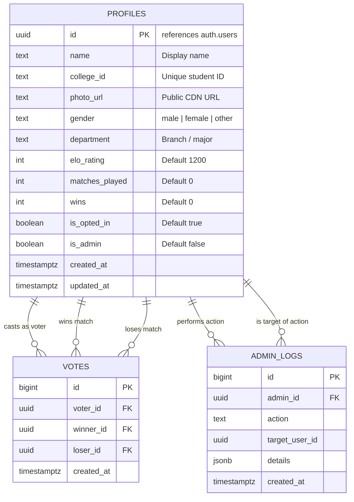

# Kannadi (കണ്ണാടി) — System Architecture

**Kannadi** is an opt-in, mobile-first peer ranking web application tailored for college communities. It uses a "King of the Hill" continuous matchup format governed by an Elo rating algorithm, accompanied by an irrevocable participation agreement and an administrative moderation dashboard.

---

## 1. High-Level Architecture

```mermaid
flowchart TD
    subgraph Client ["Client Layer (React + Vite + Tailwind)"]
        UI["Mobile-First UI (Tailwind CSS)"]
        State["App & Auth State (React Context)"]
        Engine["Matchup Pre-loader & Animation Engine (Framer Motion)"]
    end

    subgraph Supabase ["Backend as a Service (Supabase)"]
        Auth["Supabase Auth (Google OAuth)"]
        DB[("PostgreSQL Database")]
        RPC["PL/pgSQL Functions (Atomic Elo & Matchmaking)"]
        Storage["Storage CDN ('avatars' bucket)"]
        RLS["Row-Level Security (RLS) Engine"]
    end

    UI --> State
    State --> Engine
    UI -->|Sign In / Session| Auth
    UI -->|Photo Upload (Canvas Compressed)| Storage
    Engine -->|Poll Challenger via RPC| RPC
    Engine -->|Submit Vote via RPC| RPC
    RPC --> DB
    State -->|Fetch Profiles & Leaderboard| RLS
    RLS --> DB
```

---

## 2. Tech Stack

| Layer | Technology | Purpose |
| :--- | :--- | :--- |
| **Frontend Framework** | React 19 / 18 + Vite | Blazing fast build & client SPA |
| **Language** | TypeScript | Strong typing for profiles, matchups, and database contracts |
| **Styling** | Tailwind CSS v4 / v3 | Utility-first, responsive, dark/light theme ready |
| **Motion & Gestures** | Framer Motion | Smooth card swaps, victory slides, and exit animations |
| **Icons & Visuals** | Lucide React + Canvas Confetti | Modern UI icons and round completion celebration |
| **Authentication** | Supabase Auth | Google OAuth provider (Standard Gmail) |
| **Database** | Supabase PostgreSQL | Relational storage with strict constraints and RLS |
| **Server Logic** | PostgreSQL Stored Procedures (RPC) | Tamper-proof Elo calculations and atomic transaction locks |
| **Asset Storage** | Supabase Storage | Public CDN for profile pictures |

---

## 3. Database Architecture & Security Model

### 3.1 Entity Relationship Diagram



### 3.2 SQL Schema & Policies

```sql
-- Enable necessary extensions
create extension if not exists "uuid-ossp";

-- 1. Profiles Table
create table public.profiles (
  id uuid references auth.users on delete cascade primary key,
  name text not null,
  college_id text not null,
  photo_url text not null,
  gender text check (gender in ('male', 'female', 'other')),
  department text,
  elo_rating integer default 1200 not null,
  matches_played integer default 0 not null,
  wins integer default 0 not null,
  is_opted_in boolean default true not null,
  is_admin boolean default false not null,
  created_at timestamp with time zone default timezone('utc'::text, now()) not null,
  updated_at timestamp with time zone default timezone('utc'::text, now()) not null
);

create index idx_profiles_active_elo on public.profiles (is_opted_in, elo_rating);
create index idx_profiles_college_id on public.profiles (college_id);

-- 2. Votes Table
create table public.votes (
  id bigint generated always as identity primary key,
  voter_id uuid references public.profiles(id) on delete set null,
  winner_id uuid references public.profiles(id) on delete cascade not null,
  loser_id uuid references public.profiles(id) on delete cascade not null,
  created_at timestamp with time zone default timezone('utc'::text, now()) not null
);

create index idx_votes_voter_created on public.votes (voter_id, created_at desc);

-- 3. Admin Audit Logs Table
create table public.admin_logs (
  id bigint generated always as identity primary key,
  admin_id uuid references public.profiles(id) on delete set null,
  action text not null, -- 'DELETE_PROFILE', 'ADJUST_ELO', 'TOGGLE_VISIBILITY'
  target_user_id uuid,
  details jsonb default '{}'::jsonb,
  created_at timestamp with time zone default timezone('utc'::text, now()) not null
);

-- 4. Helper Function: Is Admin
create or replace function public.is_admin()
returns boolean
language sql
security definer
stable
as $$
  select coalesce(
    (select is_admin from public.profiles where id = auth.uid()),
    false
  );
$$;

-- 5. Row-Level Security
alter table public.profiles enable row level security;
alter table public.votes enable row level security;
alter table public.admin_logs enable row level security;

-- Profiles: Authenticated read
create policy "Allow read for active profiles"
  on public.profiles for select
  to authenticated
  using (is_opted_in = true or auth.uid() = id or public.is_admin());

-- Profiles: Users can update name/photo; cannot elevate role or change opted_in
create policy "Allow individual profile update"
  on public.profiles for update
  to authenticated
  using (auth.uid() = id or public.is_admin())
  with check (
    public.is_admin() or (
      auth.uid() = id
      and is_opted_in = true
      and is_admin = false
    )
  );

-- Profiles: Irrevocable registration insert
create policy "Allow individual insert"
  on public.profiles for insert
  to authenticated
  with check (auth.uid() = id and is_opted_in = true and is_admin = false);

-- Profiles: Only admin delete
create policy "Allow admin delete"
  on public.profiles for delete
  to authenticated
  using (public.is_admin());

-- Votes: Users record their own vote
create policy "Allow insert vote"
  on public.votes for insert
  to authenticated
  with check (auth.uid() = voter_id);

-- Votes: Admin inspects all, regular user inspects own
create policy "Allow select votes"
  on public.votes for select
  to authenticated
  using (public.is_admin() or auth.uid() = voter_id);

-- Admin logs: Admins only
create policy "Allow admin logs access"
  on public.admin_logs for all
  to authenticated
  using (public.is_admin());
```

---

## 4. Business Logic & Stored Procedures

### 4.1 Atomic Elo Rating Engine (`submit_matchup_vote`)
To prevent client-side manipulation and handle race conditions when two users vote on the same person simultaneously:

$$\begin{aligned}
E_A &= \frac{1}{1 + 10^{(R_B - R_A) / 400}}, \quad E_B = \frac{1}{1 + 10^{(R_A - R_B) / 400}} \\
R'_A &= R_A + K \cdot (1 - E_A), \quad R'_B = R_B + K \cdot (0 - E_B)
\end{aligned}$$

* $K = 32$ for profiles with $< 20$ matches (accelerates convergence).
* $K = 16$ for profiles with $\ge 20$ matches (stability).

```sql
create or replace function submit_matchup_vote(
  p_winner_id uuid,
  p_loser_id uuid
)
returns void
language plpgsql
security definer
as $$
declare
  v_voter_id uuid := auth.uid();
  v_winner_rating int;
  v_loser_rating int;
  v_winner_matches int;
  v_loser_matches int;
  v_k_winner int;
  v_k_loser int;
  v_expected_winner float;
  v_expected_loser float;
  v_new_winner_rating int;
  v_new_loser_rating int;
begin
  if p_winner_id = p_loser_id or p_winner_id = v_voter_id or p_loser_id = v_voter_id then
    raise exception 'Invalid matchup parameters';
  end if;

  -- Lock rows in stable order to avoid deadlocks
  if p_winner_id < p_loser_id then
    select elo_rating, matches_played into v_winner_rating, v_winner_matches from public.profiles where id = p_winner_id for update;
    select elo_rating, matches_played into v_loser_rating, v_loser_matches from public.profiles where id = p_loser_id for update;
  else
    select elo_rating, matches_played into v_loser_rating, v_loser_matches from public.profiles where id = p_loser_id for update;
    select elo_rating, matches_played into v_winner_rating, v_winner_matches from public.profiles where id = p_winner_id for update;
  end if;

  v_k_winner := case when v_winner_matches < 20 then 32 else 16 end;
  v_k_loser  := case when v_loser_matches  < 20 then 32 else 16 end;

  v_expected_winner := 1.0 / (1.0 + power(10.0, (v_loser_rating - v_winner_rating)::float / 400.0));
  v_expected_loser  := 1.0 / (1.0 + power(10.0, (v_winner_rating - v_loser_rating)::float / 400.0));

  v_new_winner_rating := round(v_winner_rating + v_k_winner * (1.0 - v_expected_winner));
  v_new_loser_rating  := round(v_loser_rating  + v_k_loser  * (0.0 - v_expected_loser));

  update public.profiles
  set elo_rating = v_new_winner_rating, matches_played = matches_played + 1, wins = wins + 1, updated_at = now()
  where id = p_winner_id;

  update public.profiles
  set elo_rating = v_new_loser_rating, matches_played = matches_played + 1, updated_at = now()
  where id = p_loser_id;

  insert into public.votes (voter_id, winner_id, loser_id)
  values (v_voter_id, p_winner_id, p_loser_id);
end;
$$;
```

### 4.2 Matchmaking & Cold Start Boost (`get_next_challenger`)
Selects a challenger candidate who:
1. Is opted in (`is_opted_in = true`).
2. Is not the voter (`id != auth.uid()`).
3. Is not the current King (`id != p_king_id`).
4. Has not already been faced in this session (`id != all(p_excluded_ids)`).
5. Prioritizes profiles with $< 10$ matches played (cold-start mitigation).

```sql
create or replace function get_next_challenger(
  p_king_id uuid,
  p_excluded_ids uuid[]
)
returns setof public.profiles
language sql
stable
security definer
as $$
  select *
  from public.profiles
  where is_opted_in = true
    and id != auth.uid()
    and id != p_king_id
    and id != all(p_excluded_ids)
  order by
    (matches_played < 10) desc,
    random()
  limit 1;
$$;
```

### 4.3 Admin Procedures
```sql
-- Emergency Profile Purge
create or replace function admin_delete_profile(p_target_id uuid, p_reason text)
returns void language plpgsql security definer as $$
begin
  if not public.is_admin() then raise exception 'Unauthorized'; end if;
  insert into public.admin_logs (admin_id, action, target_user_id, details)
  values (auth.uid(), 'DELETE_PROFILE', p_target_id, jsonb_build_object('reason', p_reason));
  delete from public.profiles where id = p_target_id;
end;
$$;

-- Manual Elo Score Correction
create or replace function admin_adjust_elo(p_target_id uuid, p_new_elo int, p_reason text)
returns void language plpgsql security definer as $$
begin
  if not public.is_admin() then raise exception 'Unauthorized'; end if;
  insert into public.admin_logs (admin_id, action, target_user_id, details)
  values (auth.uid(), 'ADJUST_ELO', p_target_id, jsonb_build_object('new_elo', p_new_elo, 'reason', p_reason));
  update public.profiles set elo_rating = p_new_elo, updated_at = now() where id = p_target_id;
end;
$$;
```

---

## 5. Client Application Architecture

### 5.1 Route Tree & Access Controls
* `/` — Landing & Google Sign-In Screen.
* `/onboarding/terms` — Irrevocable Agreement Gate (cannot proceed without explicit acceptance).
* `/onboarding/profile` — Photo upload, Canvas downscaling, Name & College ID submission.
* `/arena` — 15-Round King-of-the-Hill Matchup Arena.
* `/complete` — Celebration summary screen (round stats & percentile).
* `/leaderboard` — Top rankings & personal standing card.
* `/admin` — Protected administrator dashboard (verified against `is_admin()`).

### 5.2 Performance & Zero-Flicker Matchmaking
* **Pipeline Pre-Fetching:** While the user is deciding between King $A$ and Challenger $B$, Challenger $C$ is already queried and its image is preloaded into the browser cache (`new Image().src = challengerC.photo_url`).
* **Optimistic Transitions:** When a card is clicked, the swap animation starts instantly with zero layout shift; `submit_matchup_vote` runs asynchronously in the background.
* **Client-Side Image Optimization:** Profile photos uploaded by users are downscaled using HTML5 Canvas to a maximum resolution of $800 \times 1000$ at $85\%$ JPEG quality before upload, keeping file sizes under 250KB and ensuring high CDN hit speeds.

---

## 6. Security, Privacy & Integrity Guarantees

1. **No Lurker / Free-Rider Voters:**
   Only registered users with an active photo in the pool can vote. Users cannot vote anonymously.
2. **Irrevocable Participation Policy:**
   No client-facing delete/deactivation button exists. Once agreed, users remain part of the competition unless removed by an administrator.
3. **Anti-Brigading & Rate Limiting:**
   A maximum of 15 rounds per session, and maximum 3 completed sessions per user per day.
4. **Bottom-Tier Protection:**
   The leaderboard displays Top 10 / Top 20 only. Users can inspect their own private percentile, preventing lower-ranked participants from public embarrassment.
